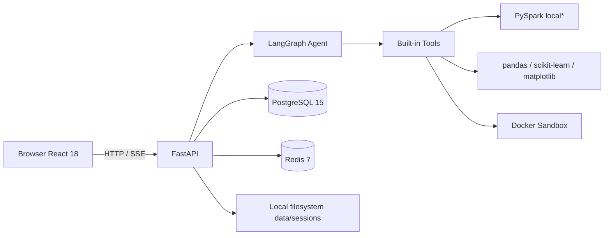

<p align="center">
  <a href="./README.md">简体中文</a> · <b>English</b>
</p>

<h1 align="center">Data Analysis Agent</h1>

<p align="center">Analyze CSV / Excel data, build visualizations, and train machine learning models with natural language</p>

---

## Overview

Data Analysis Agent is a conversational web application for data analysis. Upload a dataset, ask a question in plain language, and the agent plans and invokes analysis tools to profile data, aggregate metrics, engineer time features, and train or evaluate models — returning answers, tables, and charts.

- Frontend: React 18 + TypeScript + Vite + TailwindCSS + ECharts
- Backend: FastAPI + LangGraph + DeepSeek (OpenAI-compatible API)
- Compute: PySpark 3.5 local[*] + pandas + scikit-learn + matplotlib
- Storage: PostgreSQL 15 + Redis 7 + local filesystem
- Secure execution: Docker sandbox + Python AST allowlist + human approval for high-risk tools

## Features

- **Conversational analysis**: Upload `.csv` / `.tsv` / `.xlsx` / `.json`, then ask questions; tools are invoked automatically over multiple iterations.
- **Built-in tools**: dataset profiling, dimension aggregation, time features, regression/classification modeling, model evaluation, chart data generation, and session memory queries.
- **SSE streaming**: Streams reasoning, tool calls, progress, and results in real time, with `Last-Event-ID` resume support.
- **Human approval**: Pauses before high-risk actions such as arbitrary Python execution until the user confirms.
- **Rich results**: Tables, ECharts visualizations, and model metrics rendered inline in the chat and artifact panel.
- **Accounts**: Registration, login with image captcha, profile, password change, and account deletion.
- **Anonymous quota**: Visitors can create 2 sessions with up to 3 messages each, then are prompted to sign in.
- **MCP support**: Read-only analysis tools exposed as MCP tools via fastapi-mcp.

## Architecture



Request flow:

1. The frontend uploads files in chunks and validates size, extension, file signature, and SHA-256.
2. Submitting a question creates a background run; a per-session mutex serializes execution.
3. The LangGraph state machine loops through `agent → tool_executor → agent → ... → finish`.
4. High-risk tools enter `approval_gate`, pause via `interrupt`, and emit an approval event to the frontend.
5. Events are written to Redis before being streamed over SSE, allowing reconnects to resume by event ID.

## Built-in tools

| Tool | Description |
| --- | --- |
| `profile_dataset` | Row count, column types, missing rates, basic statistics, sample rows |
| `aggregate_plays` | Aggregate plays/downloads/favorites or active users by dimension |
| `build_time_features` | Daily/hourly/weekly series with lag and rolling features |
| `train_predictive_model` | Train regression or classification models; forecast future plays |
| `evaluate_model` | Validation metrics, feature importance, and predictions |
| `generate_chart_data` | Aggregated data for bar, line, and scatter charts |
| `query_session_memory` | Retrieve completed steps and summaries to avoid recomputation |
| `execute_python_snippet` | Run restricted Python in an isolated sandbox (requires approval) |

## Quick start

### Prerequisites

- Docker Desktop or Docker Engine + Compose v2
- Node.js 22 LTS (only for local frontend development)
- A DeepSeek API key (or another OpenAI-compatible service)

### 1. Configure environment

```bash
git clone <your-repo-url>
cd data-analyse-agent
cp .env.example .env
```

Edit `.env` and fill in at least:

```dotenv
POSTGRES_PASSWORD=<strong-random-password>
OPENAI_API_KEY=<your-api-key>
AUTH_SECRET_KEY=<random-long-string, e.g. openssl rand -hex 32>
```

`.env` is ignored by `.gitignore` and **must never be committed**.

### 2. Start the development stack

```bash
# PostgreSQL, Redis, and the backend (development image with hot reload)
docker compose up -d postgres redis backend

# Apply database migrations
docker compose exec backend alembic upgrade head

# Optional: build the sandbox image to enable custom code execution
docker compose --profile sandbox build sandbox
```

Start the frontend dev server:

```bash
cd frontend
npm ci
npm run dev
```

- Frontend: http://localhost:5173
- API docs: http://localhost:8000/api/docs
- Health check: http://localhost:8000/api/health/live

### 3. Production deployment

```bash
docker compose -f docker-compose.prod.yml build backend frontend
docker compose -f docker-compose.prod.yml --profile sandbox build sandbox
docker compose -f docker-compose.prod.yml up -d postgres redis
docker compose -f docker-compose.prod.yml run --rm backend alembic upgrade head
docker compose -f docker-compose.prod.yml up -d backend frontend
```

The app listens on `127.0.0.1:18080` by default; adjust `APP_BIND_ADDRESS` and `APP_HTTP_PORT` in `.env` as needed. Also verify:

- `HOST_DATA_DIR`: absolute host path mounted into the sandbox container.
- `DOCKER_GID`: GID of the docker group for `/var/run/docker.sock`.
- `AUTH_SECRET_KEY`: replace the placeholder with a random long string.

## Configuration

See [.env.example](./.env.example) for all options. Common settings:

| Variable | Description | Default |
| --- | --- | --- |
| `POSTGRES_PASSWORD` | Database password (required) | - |
| `OPENAI_API_KEY` | LLM API key (required) | - |
| `OPENAI_BASE_URL` | OpenAI-compatible endpoint | `https://api.deepseek.com` |
| `MODEL_NAME` | Default model | `deepseek-chat` |
| `AUTH_SECRET_KEY` | Session cookie signing key | Dev placeholder; change in production |
| `ANON_MAX_SESSIONS` | Max sessions for anonymous users | `2` |
| `ANON_MAX_MESSAGES_PER_SESSION` | Max messages per anonymous session | `3` |
| `MAX_UPLOAD_SIZE_MB` | Max upload size | `2048` |
| `MAX_ITERATIONS` | Max agent iterations per turn | `10` |
| `APPROVAL_TIMEOUT_SECONDS` | Approval timeout | `300` |
| `SANDBOX_TIMEOUT_SECONDS` | Sandbox execution timeout | `30` |
| `HOST_DATA_DIR` | Host data directory (required in production) | - |

## API overview

| Method | Path | Description |
| --- | --- | --- |
| `POST` | `/api/files` | Upload a data file |
| `GET` | `/api/files?session_id=` | List files in a session |
| `DELETE` | `/api/files/{file_id}` | Delete a file |
| `POST` | `/api/sessions` | Create a session |
| `GET` | `/api/sessions` | List sessions |
| `GET` | `/api/sessions/{id}` | Session details |
| `DELETE` | `/api/sessions/{id}` | Delete a session |
| `GET` | `/api/sessions/{id}/messages` | List messages |
| `POST` | `/api/sessions/{id}/messages` | Submit a question |
| `GET` | `/api/sessions/{id}/stream` | SSE event stream |
| `GET` | `/api/sessions/{id}/artifacts` | Session artifacts |
| `POST` | `/api/approvals/{approval_id}` | Submit an approval decision |
| `GET` | `/api/auth/captcha` | Get an image captcha |
| `POST` | `/api/auth/register` | Register |
| `POST` | `/api/auth/login` | Log in |
| `POST` | `/api/auth/logout` | Log out |
| `GET` / `PATCH` / `DELETE` | `/api/auth/me` | Current user / update profile / delete account |
| `POST` | `/api/auth/change-password` | Change password |
| `POST` | `/api/tools/profile` `aggregate` `chart` `memory` | Invoke read-only tools directly |
| `GET` | `/api/config` | Frontend runtime configuration |
| `GET` | `/api/health/live` `/api/health/ready` | Liveness / readiness checks |

## Project layout

```text
data-analyse-agent/
├── backend/
│   ├── app/
│   │   ├── api/            # Auth, sessions, files, approvals, tools, health
│   │   ├── agent/          # LangGraph graph, nodes, prompts, termination
│   │   ├── tools/          # Tool implementations and registry
│   │   ├── services/       # Files, sessions, runs, SSE, storage, sandbox
│   │   ├── spark_jobs/     # PySpark jobs
│   │   ├── sandbox/        # Docker sandbox and AST validation
│   │   ├── db/             # SQLAlchemy models and connection
│   │   └── schemas/        # Pydantic request/response models
│   ├── alembic/            # Database migrations
│   ├── tests/              # Backend tests
│   └── Dockerfile
├── frontend/
│   ├── src/
│   │   ├── components/     # Chat, sidebar, artifacts, auth, profile
│   │   ├── hooks/          # SSE and chat actions
│   │   ├── store/          # Zustand stores
│   │   ├── api/            # API client
│   │   └── types/          # TypeScript types
│   ├── e2e/                # Playwright end-to-end tests
│   └── Dockerfile
├── sandbox/                # Sandbox image
├── document/               # Requirements and development docs
├── docker-compose.yml      # Development stack
└── docker-compose.prod.yml # Production stack
```

Runtime files are isolated under `data/sessions/<session_id>/<run_id>/`; the `data/` directory is ignored by Git.

## Testing

```bash
# Backend (skip slow tests that need Spark / real data)
docker compose exec backend pytest -m "not slow"

# Backend slow tests (Spark, sandbox)
docker compose exec backend pytest -m slow

# Frontend unit tests and build
cd frontend
npm run test
npm run build

# End-to-end tests (requires running frontend and backend)
npm run test:e2e
```

## Security notes

- `.env`, keys, certificates, uploaded data, runtime artifacts, and logs are all ignored via `.gitignore`.
- Always replace `AUTH_SECRET_KEY` and use a strong random `POSTGRES_PASSWORD` in production.
- Sandbox containers run as non-root with networking disabled, a read-only root filesystem, and memory/time limits.
- The LLM only receives resource IDs, never physical paths.
- High-risk tools require explicit human approval.
- If a key was ever committed or exposed, revoke and rotate it immediately.

## Documentation

Development docs and sample data are kept locally and are not published with this repository.

## License

No license file is included yet. Add an appropriate LICENSE before publishing or allowing reuse.

---

<p align="center">
  <a href="./README.md">← 简体中文版本</a>
</p>
