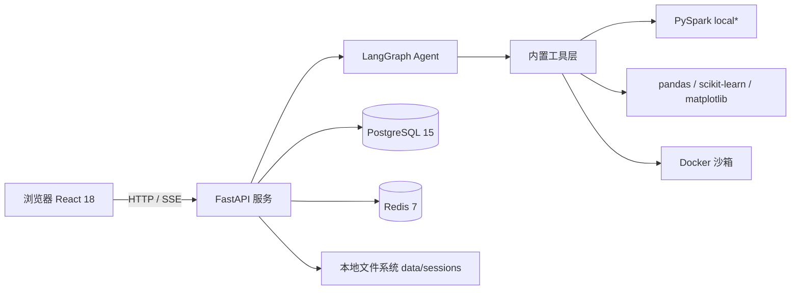

<p align="center">
  <b>简体中文</b> · <a href="./README.en.md">English</a>
</p>

<h1 align="center">Data Analysis Agent</h1>

<p align="center">用自然语言完成 CSV / Excel 数据分析、可视化与机器学习建模</p>

---

## 项目简介

Data Analysis Agent 是一个对话式的数据分析 Web 应用。上传数据文件后，直接用自然语言提问，Agent 会自动规划并调用分析工具，完成数据概况、维度聚合、时间特征、模型训练与预测，并以文字、表格和图表的形式返回结果。

- 前端：React 18 + TypeScript + Vite + TailwindCSS + ECharts
- 后端：FastAPI + LangGraph + DeepSeek（OpenAI 兼容接口）
- 计算：PySpark 3.5 local[*] + pandas + scikit-learn + matplotlib
- 存储：PostgreSQL 15 + Redis 7 + 本地文件系统
- 安全执行：Docker 沙箱 + Python AST 白名单校验 + 高风险工具人工审批

## 主要功能

- **对话式分析**：上传 `.csv` / `.tsv` / `.xlsx` / `.json`，提问后自动多轮调用工具，无需编写代码。
- **内置分析工具**：数据概况、维度聚合、时间特征、回归/分类建模、模型评估、图表数据生成、会话记忆查询。
- **SSE 流式输出**：实时推送思考、工具调用、进度与结果，支持 `Last-Event-ID` 断点续传。
- **人工审批**：执行任意 Python 代码等高风险操作前暂停，等待用户确认后继续。
- **结果可视化**：表格、ECharts 图表、模型指标在对话流和产物面板中内联渲染。
- **账号体系**：注册 / 登录（图形验证码）/ 个人中心 / 修改密码 / 删除账号。
- **匿名体验**：未登录用户可创建 2 个会话、每个会话最多 3 轮提问，超出后引导登录。
- **MCP 支持**：通过 fastapi-mcp 将只读分析工具暴露为 MCP 工具。

## 架构概览



核心执行链路：

1. 前端分块上传文件并校验（大小、扩展名、文件签名、SHA-256）。
2. 提交问题后创建后台运行，会话级互斥锁保证同一会话串行执行。
3. LangGraph 状态图循环执行：`agent → tool_executor → agent → ... → finish`。
4. 高风险工具进入 `approval_gate`，通过 `interrupt` 暂停并向前端推送审批事件。
5. 事件先写入 Redis 再通过 SSE 推送，断线后可按事件 ID 恢复。

## 内置工具

| 工具 | 说明 |
| --- | --- |
| `profile_dataset` | 查看行数、字段类型、缺失率、基础统计与样本行 |
| `aggregate_plays` | 按维度聚合播放/下载/收藏次数或活跃用户数 |
| `build_time_features` | 构建按天/小时/星期的序列及滞后、滚动特征 |
| `train_predictive_model` | 训练回归或分类模型，可预测未来若干天的播放量 |
| `evaluate_model` | 查看验证指标、特征重要性与预测结果 |
| `generate_chart_data` | 生成柱状图、折线图、散点图所需的聚合数据 |
| `query_session_memory` | 查询本会话已完成步骤与摘要，避免重复计算 |
| `execute_python_snippet` | 在隔离沙箱中执行受限 Python 代码（需人工审批） |

## 快速开始

### 环境要求

- Docker Desktop 或 Docker Engine + Compose v2
- Node.js 22 LTS（仅本地开发前端时需要）
- 一个 DeepSeek API Key（或其他 OpenAI 兼容服务）

### 1. 准备配置

```bash
git clone <your-repo-url>
cd data-analyse-agent
cp .env.example .env
```

编辑 `.env`，至少填写以下内容：

```dotenv
POSTGRES_PASSWORD=<强随机密码>
OPENAI_API_KEY=<你的 API Key>
AUTH_SECRET_KEY=<随机长字符串，可用 openssl rand -hex 32 生成>
```

`.env` 已被 `.gitignore` 忽略，**不要提交到版本库**。

### 2. 开发环境启动

```bash
# 启动 PostgreSQL、Redis 与后端（开发镜像，自动热重载）
docker compose up -d postgres redis backend

# 执行数据库迁移
docker compose exec backend alembic upgrade head

# 可选：构建沙箱镜像，启用自定义代码执行工具
docker compose --profile sandbox build sandbox
```

启动前端开发服务器：

```bash
cd frontend
npm ci
npm run dev
```

- 前端：http://localhost:5173
- 后端 API 文档：http://localhost:8000/api/docs
- 健康检查：http://localhost:8000/api/health/live

### 3. 生产环境部署

```bash
docker compose -f docker-compose.prod.yml build backend frontend
docker compose -f docker-compose.prod.yml --profile sandbox build sandbox
docker compose -f docker-compose.prod.yml up -d postgres redis
docker compose -f docker-compose.prod.yml run --rm backend alembic upgrade head
docker compose -f docker-compose.prod.yml up -d backend frontend
```

默认监听 `127.0.0.1:18080`，可通过 `.env` 中的 `APP_BIND_ADDRESS` 和 `APP_HTTP_PORT` 调整。生产部署还需确认：

- `HOST_DATA_DIR`：宿主机绝对路径，供沙箱容器挂载。
- `DOCKER_GID`：后端访问 `/var/run/docker.sock` 所需的 docker 组 GID。
- `AUTH_SECRET_KEY`：必须替换为随机长字符串。

## 配置项

完整配置见 [.env.example](./.env.example)，常用项如下：

| 变量 | 说明 | 默认值 |
| --- | --- | --- |
| `POSTGRES_PASSWORD` | 数据库密码，必填 | - |
| `OPENAI_API_KEY` | LLM API Key，必填 | - |
| `OPENAI_BASE_URL` | OpenAI 兼容接口地址 | `https://api.deepseek.com` |
| `MODEL_NAME` | 默认模型 | `deepseek-chat` |
| `AUTH_SECRET_KEY` | 会话 Cookie 签名密钥 | 开发占位值，生产必须修改 |
| `ANON_MAX_SESSIONS` | 匿名用户最多会话数 | `2` |
| `ANON_MAX_MESSAGES_PER_SESSION` | 匿名会话最多提问轮次 | `3` |
| `MAX_UPLOAD_SIZE_MB` | 单文件上传上限 | `2048` |
| `MAX_ITERATIONS` | Agent 单轮最大迭代次数 | `10` |
| `APPROVAL_TIMEOUT_SECONDS` | 审批超时时间 | `300` |
| `SANDBOX_TIMEOUT_SECONDS` | 沙箱执行超时 | `30` |
| `HOST_DATA_DIR` | 宿主机数据目录（生产必填） | - |

## 主要接口

| 方法 | 路径 | 说明 |
| --- | --- | --- |
| `POST` | `/api/files` | 上传数据文件 |
| `GET` | `/api/files?session_id=` | 列出会话文件 |
| `DELETE` | `/api/files/{file_id}` | 删除文件 |
| `POST` | `/api/sessions` | 创建会话 |
| `GET` | `/api/sessions` | 会话列表 |
| `GET` | `/api/sessions/{id}` | 会话详情 |
| `DELETE` | `/api/sessions/{id}` | 删除会话 |
| `GET` | `/api/sessions/{id}/messages` | 消息列表 |
| `POST` | `/api/sessions/{id}/messages` | 提交问题 |
| `GET` | `/api/sessions/{id}/stream` | SSE 事件流 |
| `GET` | `/api/sessions/{id}/artifacts` | 会话产物 |
| `POST` | `/api/approvals/{approval_id}` | 审批响应 |
| `GET` | `/api/auth/captcha` | 获取图形验证码 |
| `POST` | `/api/auth/register` | 注册 |
| `POST` | `/api/auth/login` | 登录 |
| `POST` | `/api/auth/logout` | 登出 |
| `GET` / `PATCH` / `DELETE` | `/api/auth/me` | 当前用户信息 / 修改资料 / 删除账号 |
| `POST` | `/api/auth/change-password` | 修改密码 |
| `POST` | `/api/tools/profile` `aggregate` `chart` `memory` | 直接调用只读工具 |
| `GET` | `/api/config` | 前端运行时配置 |
| `GET` | `/api/health/live` `/api/health/ready` | 存活 / 就绪检查 |

## 目录结构

```text
data-analyse-agent/
├── backend/
│   ├── app/
│   │   ├── api/            # 认证、会话、文件、审批、工具、健康检查
│   │   ├── agent/          # LangGraph 状态图、节点、提示词、终止策略
│   │   ├── tools/          # 内置工具实现与注册表
│   │   ├── services/       # 文件、会话、运行、SSE、存储、沙箱调度
│   │   ├── spark_jobs/     # PySpark 作业
│   │   ├── sandbox/        # Docker 沙箱与 AST 校验
│   │   ├── db/             # SQLAlchemy 模型与连接
│   │   └── schemas/        # Pydantic 请求/响应模型
│   ├── alembic/            # 数据库迁移
│   ├── tests/              # 后端测试
│   └── Dockerfile
├── frontend/
│   ├── src/
│   │   ├── components/     # 对话、侧边栏、产物、登录与个人中心
│   │   ├── hooks/          # SSE 与聊天动作
│   │   ├── store/          # Zustand 状态
│   │   ├── api/            # API 客户端
│   │   └── types/          # TypeScript 类型
│   ├── e2e/                # Playwright 端到端测试
│   └── Dockerfile
├── sandbox/                # 沙箱镜像
├── document/               # 需求与开发文档
├── docker-compose.yml      # 开发环境
└── docker-compose.prod.yml # 生产环境
```

运行时会按 `data/sessions/<session_id>/<run_id>/` 隔离上传文件与产物；该目录已被 `.gitignore` 忽略。

## 测试

```bash
# 后端（排除需要 Spark / 真实数据的慢测试）
docker compose exec backend pytest -m "not slow"

# 后端慢测试（Spark、沙箱）
docker compose exec backend pytest -m slow

# 前端单元测试与构建
cd frontend
npm run test
npm run build

# 端到端测试（需先启动前后端）
npm run test:e2e
```

## 安全说明

- `.env`、密钥、证书、上传数据、运行产物和日志均已写入 `.gitignore`，不会进入版本库。
- 生产环境必须更换 `AUTH_SECRET_KEY`，并使用强随机 `POSTGRES_PASSWORD`。
- 沙箱容器以非 root 运行，禁用网络、只读根目录，并限制内存与执行时间。
- LLM 只接收资源 ID，不直接接触物理路径。
- 高风险工具执行前必须经过人工审批。
- 如果密钥曾被提交或公开，请立即在服务商控制台吊销并重新生成。

## 文档

开发文档与演示数据仅保留在本地，不随仓库发布。

## License

本项目暂未附带开源许可证（LICENSE）。如需公开发布或允许他人使用，请先补充合适的许可证文件。

---

<p align="center">
  <a href="./README.en.md">English Version →</a>
</p>
